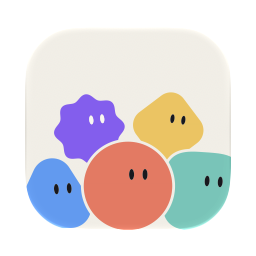
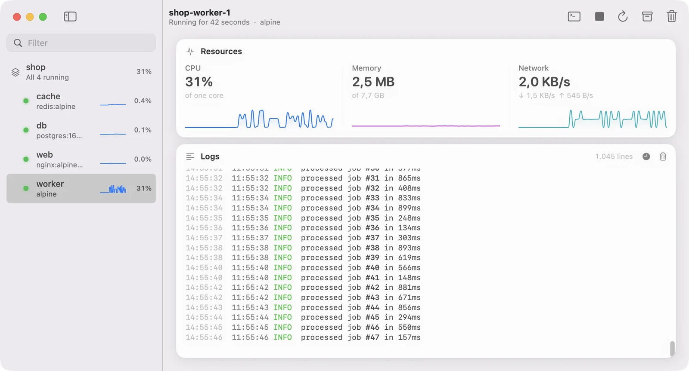

<p align="center"></p>

<h1 align="center">Kuvo Code</h1>

<p align="center"><strong>Your bots. Your computers. Any model.</strong></p>

<p align="center">
  <a href="https://github.com/serhatandic/kuvo-code/releases"></a>
  <a href="LICENSE"></a>
</p>

<picture>
  <source media="(prefers-color-scheme: dark)" srcset="docs/images/screenshot-dark.webp">
  
</picture>

Kuvo Code is a native macOS harness for coding agents that works with any
model. Its engine is [opencode](https://github.com/anomalyco/opencode),
unmodified. The GPUI desktop app in `gpui/` brings together sessions by
project, Git changes you can inspect, and a side
panel with files, terminals and a browser the agent can use too.

Use any model. Sign in with a subscription you already have, add an API key,
or start with free models that need no account.

[Releases](https://github.com/serhatandic/kuvo-code/releases)
· [Docs](https://kuvo.run/code/docs/)
· [Report a bug](https://github.com/serhatandic/kuvo-code/issues/new/choose)
· [Contact](mailto:info@kuvo.run)
· [Build from source](#build-from-source)

## Features

- **Bots.** AI teammates with a name, a look and one job each, like keeping
  the build green or sending a morning standup. They remember what they
  learn, wake themselves up on a schedule, and talk things through in group
  chats. Put one on your own server or another Mac and it keeps working while your Mac
  is off: a free, self-hosted
  [alternative to Grok Bot](https://kuvo.run/code/grok-bot-alternative/).
- **Any model.** Claude, GPT, Gemini, open models through OpenRouter,
  and the rest of opencode's providers. Pick the model and effort for
  each message.
- **Changes.** See changed lines under each file in the Changes tab. Stage,
  unstage, discard or commit changes through the box.
- **Files, terminals and a browser.** The side panel holds them as tabs: the
  project's files with code highlighted and Markdown rendered, your shell in
  the project folder, and a web browser.
- **Browsing for the agent, with any model.** The agent opens pages in the
  panel's browser, reads them, clicks, types and scrolls, and you see every
  step.
- **Sessions on your computers.** Add another Mac or Linux machine over SSH
  or with an installer code. Switch to its sessions, bots and settings from the
  desktop. Files and Changes follow the conversation's computer. The browser
  view and interactive terminals need a socket-capable connection.
- **Attach anything.** Drop, paste or pick files of any kind.
- **Plans and spend in the menu bar.** Limits with pace and reset times, and
  spend, for the accounts you connect: GitHub Copilot, ChatGPT (Codex),
  OpenCode, OpenRouter and Z.ai.
- **A native app.** A Rust interface built with GPUI.

## Getting started

Kuvo Code needs a Mac with Apple silicon and macOS 26 or later.

1. Use the current maintainer build or [build from source](#build-from-source).
   The first GPUI release is still in [release verification](docs/releases.md).
2. Open the packaged app. It installs the local box and verifies the engine
   download before it runs.
3. Open **Accounts** (⇧⌘K) to sign in or add an API key, or start with the
   free models.
4. Open a project folder (⌘O) and tell the agent what to build. It can read,
   edit and run things there. To approve each edit and command first, choose
   **Ask First** in the composer's mode menu.

The [docs](https://kuvo.run/code/docs/) cover sessions, reviewing changes, the
side panel and the usage menu.

## How it works

- **The engine is opencode itself**: the official, signed `@opencode/cli`
  binary, unmodified. Kuvo Code downloads the version it's written against,
  checks its checksum and its code signature, and keeps it in
  the box’s `~/.kuvo-code/engine` directory.
- **A private server runs in the background**, `opencode serve --stdio --port 0`
  with a random password. Kuvo Helper starts the local box, whose keeper runs the
  engine and the coding agents' bridge even when the app is closed. The desktop
  app connects to the box and follows its event stream to show live transcripts.
- **Every computer runs the same box.** Its engine versions, sessions,
  settings, agents and browser live in `~/.kuvo-code`. On macOS, Kuvo
  Helper provides Keychain access. Linux keeps vault secrets encrypted in
  the box home. The legacy Application Support box is a 0.7 import source.
- **Claude Code, Codex, Cursor, Grok and Antigravity** run beside opencode
  through the box's agents bridge. Sign in on the computer where they run.
  A conversation can hand over to another agent, and Custom Auto can use
  your model lists.
- **Remote access** uses paired relay or addressed SSH. Boxes exchange
  end-to-end encrypted peer messages without the desktop. Their sessions,
  scheduled wake-ups and group chats keep running with the desktop closed.
- **The agent's browser** is Chrome for Testing on its box. The box installs
  and verifies the browser and its dependencies. Agents can read and interact
  with pages using its tools. The panel can show the live page over local or
  paired-relay connections.
- **Updates.** Sparkle updates the installed desktop app. The main computer
  selects a signed box release for the setup. The boxes stage it while you
  work, then follow the main's running release. A failed switch can roll back.
- **The usage menu** shows what the box reads from the accounts you connect. Codex usage
  comes from the Codex app’s sign-in on your Mac. The box renews sign-ins when they expire, as those tools would.

## Build from source

Local builds are for self-use and maintainer work.

You need Rust and Xcode 27 or later.

```sh
git clone https://github.com/serhatandic/kuvo-code.git
cd kuvo-code
cd gpui
../scripts/cargo-locked.sh run -p kuvo
```

See [gpui/README.md](gpui/README.md) for Rust setup and desktop app builds,
and [box/README.md](box/README.md) for the box. See
[CONTRIBUTING.md](CONTRIBUTING.md) for maintainer build and test instructions.
See [How Kuvo works](docs/architecture/how-kuvo-works.md) for the architecture.

## Contributing and security

Kuvo Code does not accept outside pull requests or code contributions.
Bug reports and ideas are welcome as [GitHub issues](https://github.com/serhatandic/kuvo-code/issues).
Report vulnerabilities privately as described in the [security policy](SECURITY.md).

## License

Kuvo Code is source-available under the
[PolyForm Noncommercial License 1.0.0](LICENSE). You may use, study, modify,
and redistribute it for permitted noncommercial purposes. Commercial use,
including monetizing a fork or derivative, requires a separate written license
from the copyright holder: write to [info@kuvo.run](mailto:info@kuvo.run). See [NOTICE](NOTICE) for the required copyright
notice and [THIRD_PARTY_LICENSES.txt](THIRD_PARTY_LICENSES.txt) for the
licenses of included dependencies.

Kuvo Code is an independent project. It isn't affiliated with opencode or with
the companies whose models and tools it works with.
