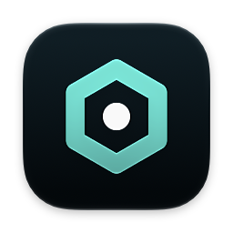
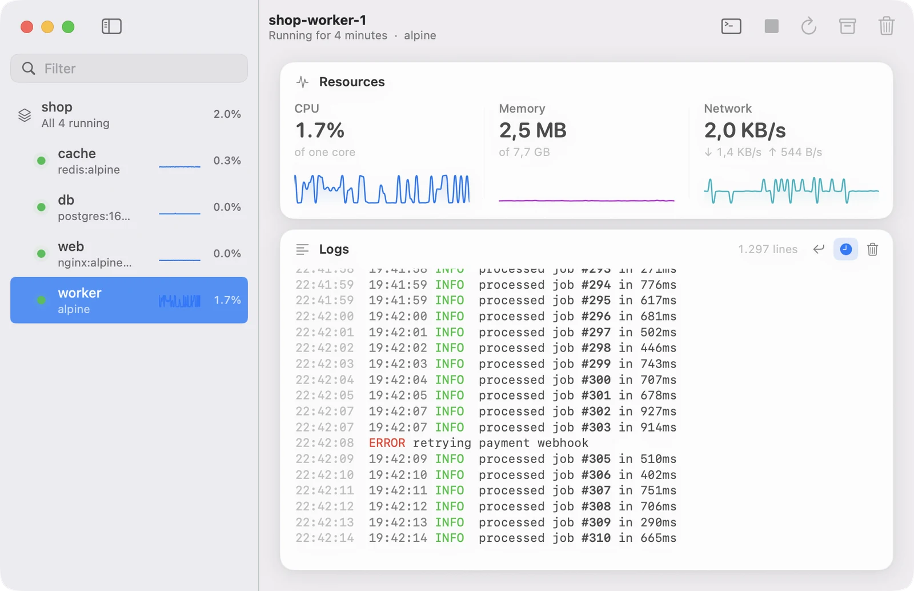

<p align="center"></p>

<h1 align="center">Kuvo Box</h1>

<p align="center"><strong>Docker for your Mac. None of the weight.</strong></p>

<p align="center">
  <a href="https://github.com/serhatandic/kuvo-box/actions/workflows/ci.yml"></a>
  <a href="https://github.com/serhatandic/kuvo-box/releases"></a>
  <a href="LICENSE"></a>
</p>



Kuvo Box is a native macOS app that runs the real Docker Engine in a small Linux
virtual machine. It's a 3 MB download, it's ready about three seconds after you
open it, and it stays quiet when you're not looking at it.

You keep using the `docker` command, Compose and your existing scripts. Kuvo Box
gives them an engine to talk to and a window to see what's running.

[Download for macOS](https://github.com/serhatandic/kuvo-box/releases/latest/download/Kuvo.dmg)
· [Docs](https://kuvo.run/box/docs/)
· [Report a bug](https://github.com/serhatandic/kuvo-box/issues/new/choose)
· [Build from source](#build-from-source)

## Features

- **The real Docker Engine.** `dockerd` from Alpine Linux, not a
  reimplementation. Compose, builds, volumes and networks work as they do on
  Linux.
- **Ports on localhost.** Published ports are forwarded to `127.0.0.1` as soon
  as a container starts.
- **Bind mounts that just work.** `/Users` is shared with the VM at the same
  path, so `-v "$PWD":/app` means what you expect.
- **Intel images too.** `linux/amd64` images run through Rosetta.
- **A native app.** SwiftUI and AppKit, no web view. Compose projects, live
  resource graphs, colored logs, a terminal in every container, and a menu bar
  item.
- **A CLI for people and agents.** `kuvo` creates containers, runs commands
  with real exit codes and copies files, so coding agents can work in a
  container instead of on your Mac.

## Getting started

Kuvo Box needs a Mac with Apple silicon and macOS 15 or later.

1. [Download Kuvo.dmg](https://github.com/serhatandic/kuvo-box/releases/latest/download/Kuvo.dmg), open it, and drag Kuvo Box onto the
   Applications folder.
2. Open it. The first launch downloads Alpine Linux and installs Docker into
   the VM, which takes a minute or two.
3. When Kuvo Box asks to be used for the `docker` command, choose **Use Kuvo Box**. It
   creates a Docker context called `kuvo` and makes it the default for every
   terminal, and it stays that way after a restart. To do it yourself later:

   ```sh
   docker context create kuvo --docker host=unix://$HOME/.kuvo/docker.sock
   docker context use kuvo
   ```

4. Run something:

   ```sh
   docker run -d -p 8080:80 nginx:alpine
   ```

> [!WARNING]
> Opening Docker Desktop switches the context back to Docker Desktop. Run
> `docker context use kuvo` to switch back to Kuvo Box, and
> `docker context use desktop-linux` whenever you want Docker Desktop again.

If you don't have the `docker` command, see
[Installation](https://kuvo.run/box/docs/installation/#the-docker-command). The
[docs](https://kuvo.run/box/docs/) cover Compose, the app, the CLI and
troubleshooting.

## The kuvo command

The `kuvo` command ships inside the app and is added to your PATH when Kuvo Box
first opens.

```text
$ kuvo new bench --cpus 2 --memory 2g
Created bench from ubuntu:24.04.
$ kuvo cp ~/code/parser bench
Copied 214 files (1.8 MB) to bench:/workspace/parser.
$ kuvo exec -w /workspace/parser bench "make test"
```

See the [CLI reference](https://kuvo.run/box/docs/cli/).

## How it works

Kuvo Box boots Alpine Linux with Apple's Virtualization framework and installs the
stock Docker packages on first launch. The Docker socket is relayed over vsock
to `~/.kuvo/docker.sock`, published ports are bridged to localhost, and `/Users`
is shared with virtiofs. The whole app is one Swift binary with three
dependencies, and it keeps itself up to date with signed updates. See [How it works](https://kuvo.run/box/docs/architecture/) for
details, and [Performance](https://kuvo.run/box/docs/performance/) for how it
compares with Docker Desktop.

## Build from source

You need Xcode 16 or later.

```sh
git clone https://github.com/serhatandic/kuvo-box.git
cd kuvo-box
./scripts/build-app.sh
open build/Kuvo.app
```

For development, `./scripts/run.sh` builds and runs a debug version. See
[CONTRIBUTING.md](CONTRIBUTING.md) for more.

## Contributing and security

Bug reports and focused pull requests are welcome; read
[CONTRIBUTING.md](CONTRIBUTING.md) first. Please report vulnerabilities
privately, as described in the [security policy](SECURITY.md).

## License

Kuvo Box is source-available under the
[PolyForm Noncommercial License 1.0.0](LICENSE). You may use, study, modify,
and redistribute it for permitted noncommercial purposes. Commercial use,
including monetizing a fork or derivative, requires a separate written license
from the copyright holder. See [NOTICE](NOTICE) for the required copyright
notice and [THIRD_PARTY_LICENSES.txt](THIRD_PARTY_LICENSES.txt) for the
licenses of bundled dependencies.

Contributions are welcome under the terms in [CONTRIBUTING.md](CONTRIBUTING.md)
and the [Contributor License Agreement](CONTRIBUTOR_LICENSE_AGREEMENT.md).
Those terms let the project owner continue to offer commercial licenses.

Docker is a trademark of Docker, Inc. Kuvo Box is not affiliated with Docker, Inc.
